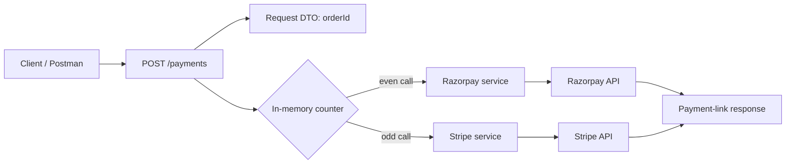

# Payment Gateway Integration | Java & Spring Boot

A focused backend service project exploring how a REST API can request hosted payment links from two payment providers: Razorpay and Stripe. Built with Java 17 and Spring Boot, it separates the HTTP entry point from provider-specific integration code and gives reviewers a concrete starting point for discussing payment orchestration, external SDKs, and the safety requirements around money-moving systems.

**This is a learning prototype, not a production payment service.** The repository is separate from [ScalerEcommerceProject](https://github.com/FaiazS/ScalerEcommerceProject/tree/master); the code reviewed does not wire this payment API into that product catalog or implement a complete cart-to-order checkout.

## What this project explores

- A Spring REST endpoint that accepts an order ID and requests a payment link.
- Separate provider service classes for Razorpay and Stripe.
- Razorpay Java SDK usage to construct a hosted payment-link request.
- Stripe Java SDK usage to create a price and hosted payment link.
- A small request DTO and dependency-injected controller structure.
- The design challenges of connecting payment operations to real order data and safely handling credentials, retries, and payment status.

## How the code is organized

```text
src/main/java/com/scaler/paymentgatewayintegration/
├── PaymentConfigurations/
│   └── RazorPayClient.java
├── PaymentContollers/
│   └── PaymentController.java
├── PaymentDTOS/
│   └── GeneratePaymentLinkRequestDTO.java
├── PaymentServices/
│   ├── PaymentService.java
│   ├── RazorPayPaymentGatewayIntegrationService.java
│   └── StripePaymentGateWayIntegrationService.java
└── PaymentGateWayIntegrationApplication.java
```

The request path represented by the code is:



## API shape in the source

### Generate a payment link

`POST /payments`

Request body:

```json
{
  "orderId": 123
}
```

The controller returns the provider SDK's payment-link representation as a string. The current provider selection alternates between Razorpay and Stripe using an in-memory counter: one request goes to Razorpay, the next to Stripe, and so on. This demonstrates two integration paths, but a counter is not a safe or predictable provider-selection strategy for real transactions.

## Provider implementation details

### Razorpay

The Razorpay service builds a payment-link request with INR currency, an order reference based on the supplied order ID, a short expiry, and a demo description. The amount is currently fixed in the service rather than calculated from a persisted order. The repository also contains a Razorpay client configuration class intended to create the SDK client from configuration values.

### Stripe

The Stripe service uses the Stripe Java SDK to create a recurring INR price and then create a hosted payment link with a post-completion redirect. The current implementation is a provider API experiment; it does not derive a one-time charge from an order total or persist a mapping between the order and Stripe session/link.

## Technology

- Java 17
- Spring Boot 3.4.1
- Spring Web / Spring MVC
- Razorpay Java SDK
- Stripe Java SDK
- Maven Wrapper

The Maven file also includes JDBC, JPA, and MySQL dependencies; the payment controller and provider services reviewed do not currently use them to persist orders or payment state.

## Why this project matters

Payment integration is not just an SDK call. A reliable checkout must bind a payment to a trusted order total, handle duplicate requests safely, verify provider notifications, and keep order/payment states consistent when networks fail or users retry. This prototype creates a foundation for exploring those system boundaries and for extending a basic REST service into a more robust payment workflow.

For a candidate transitioning into software engineering from a non-technical degree and operations experience, this project demonstrates initiative in learning Java backend development, Spring dependency injection, REST API structure, third-party SDK integration, and the engineering discipline required to evaluate security and reliability—not merely to make a happy-path API call.

## Configuration and security

Provider credentials must be supplied through environment variables or a local, ignored configuration file. **Never commit payment secrets, database credentials, or real customer information.** Before publishing or deploying this repository, rotate any credential that has been committed and replace personal details with synthetic test data.

The reviewed source contains a hard-coded Stripe test credential and personal customer details in the Razorpay request. They are intentionally not repeated here. Remove them from the code and rotate the exposed credential; deleting a secret from the latest commit does not invalidate it.

## Current implementation status

The code is useful to inspect as an integration prototype, but the current `master` branch needs fixes before it can be presented as a runnable or production-safe payment service:

- Provider service classes are declared `abstract` while the controller requests them as injectable dependencies.
- The Razorpay configuration has malformed property placeholders and does not construct/configure the SDK client as expected by the service.
- The Stripe path passes the price-creation parameter object's string form where the created price ID should be used for a payment-link line item.
- Provider choice relies on process-local request order; it is not tied to configuration, an order, or a customer decision.
- The Razorpay amount is hard-coded; order ownership, currency, and payable total are not loaded from a trusted order record.
- No payment-result webhook/callback verification, signature validation, idempotency strategy, or persisted payment state is present in the reviewed code.
- The repository includes a Spring Boot test starter and an application-context test source file, but no executed test results are claimed here.

These are concrete next steps for turning the experiment into a dependable service—not features this README claims are already implemented.

## Suggested next iteration

1. Remove committed credentials and personal data; load provider keys from environment-backed configuration.
2. Make provider services concrete and repair Razorpay client construction and property binding.
3. Use a provider strategy selected explicitly through configuration or request policy.
4. Load the order and calculate the amount server-side; never trust a client-supplied total.
5. Create one-time payment sessions/links with stable order references and idempotency keys.
6. Persist payment attempts and state transitions.
7. Verify signed provider webhooks, handle retries idempotently, and reconcile asynchronous payment outcomes.
8. Add focused unit and integration tests with provider sandbox clients and synthetic fixtures.
9. Document success, failure, expiry, and duplicate-request scenarios with Postman examples.

## Related project

The product catalog is maintained separately in [ScalerEcommerceProject](https://github.com/FaiazS/ScalerEcommerceProject/tree/master). This repository should be described as a **separate payment-link integration prototype**, not as a payment module already connected to that catalog application.

## About

An independent backend engineering project demonstrating exploration of payment APIs with Java and Spring Boot. The repository makes the implementation and its next engineering challenges inspectable, providing a practical foundation for continued work in backend and payment systems.


